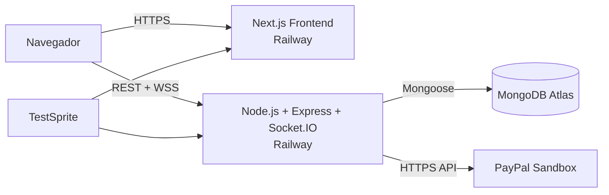

# Arquitectura — LibroYa

## Diagrama

## Responsabilidades y límites de confianza

- **Navegador (cliente)**: renderiza la UI, arma el carrito, inicia el pago. Nunca decide precios, estados ni pagos.
- **Backend**: autentica/autoriza, recalcula importes con precios de la DB, valida stock, crea/captura órdenes PayPal, verifica captura (estado, importe, moneda, id), gestiona la máquina de estados y emite eventos WebSocket.
- **MongoDB Atlas**: persiste usuarios, libros, pedidos, pagos, envíos. No se expone públicamente con credenciales privilegiadas.
- **PayPal Sandbox**: simula pagos; el backend es el único que habla con su API.

## Decisiones clave

1. Monorepo con `web/` y `server/` separados: permite que Socket.IO comparta el proceso del backend y que la lógica de pagos no dependa del navegador.
2. Precios y stock se consultan en la DB al crear el pedido: evita manipulación del total desde el cliente.
3. Máquina de estados explícita con roles por transición: evita saltos arbitrarios (Pendiente → Entregado).
4. Salas de Socket.IO asignadas por identidad JWT verificada: no se confía en un nombre de sala enviado por el navegador.
5. Idempotencia en captura de pago: solicitudes repetidas devuelven el resultado conocido.
6. Variables secretas solo en el backend; `NEXT_PUBLIC_*` únicamente URLs/Client ID público.